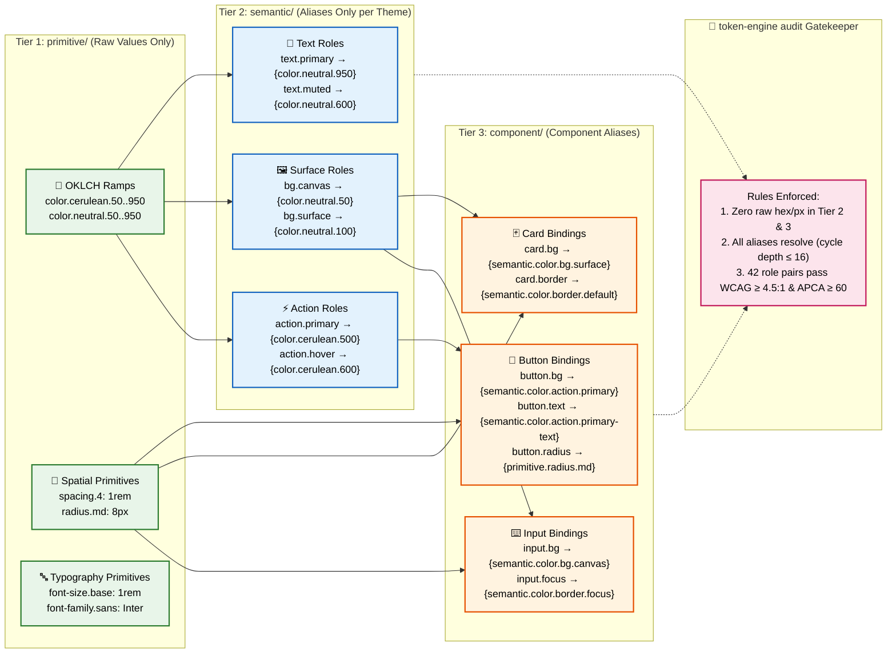

# ARCHITECTURE.md — token-engine-builder

Deep design: module contracts, token discipline, and the three load-bearing build decisions. `AGENTS.md` states the rules; this file explains why.

## 1. System overview

The architecture decouples **cognitive agent reasoning** from **deterministic mathematics**:

```mermaid
graph TB
    subgraph CognitiveLayer ["🧠 Cognitive Agent Layer (design-tokens skill)"]
        direction TB
        Agent[👤 Autonomous AI Agent]
        Discovery[🔍 Context Discovery<br/>Maturity, Shadow DOM, Package Manager]
        PaletteDesign[🎨 Socratic Palette Design<br/>Brand Anchors, Kobayashi Clusters]
        Refactor[✂️ Codebase Refactoring<br/>#hex → var(--color-*), :host Piercing]
        
        Agent --> Discovery
        Discovery --> PaletteDesign
        PaletteDesign --> Refactor
    end

    subgraph CLIEngine ["⚙️ Deterministic CLI Engine (token-engine)"]
        direction TB
        CLI[🚀 token-engine CLI<br/>src/cli/index.ts → dist/cli/]
        SyncCmd[⚡ token-engine sync<br/>Single-Pass Execution]
        SubCmds[🛠️ Subcommands<br/>init | audit | build | extract | generate | scaffold | route | diagnose | figma]
        
        CLI --> SyncCmd
        CLI --> SubCmds
    end

    subgraph Pipeline ["🔄 Core Processing Pipeline"]
        direction TB
        Extract[📝 extract<br/>CSS/TS Mining + Baseline Scan]
        Math[📐 generate<br/>11-Step OKLCH Ramps + 4px Rhythm]
        Audit[🔐 audit<br/>WCAG 2.1 AA + APCA Dual Gate]
        Build[📦 build<br/>Style Dictionary v5 Programmatic Compiler]
        
        Extract -->|tokens.config.json| Math
        Math -->|tokens/ 3-tier tree| Audit
        Audit -->|passing stamp| Build
    end

    subgraph Artifacts ["💾 Emitted Artifacts & Targets"]
        direction TB
        TokensJSON[(💾 tokens/<br/>primitive, semantic, component)]
        TokensCSS[🌐 tokens.css<br/>:host & :root Custom Properties]
        TokensJS[📜 tokens.js + tokens.d.ts<br/>Typed ESM Dictionary & Themes Map]
        ThemeCSS[🎨 theme.css<br/>Tailwind v4 @theme Block]
        PackageJSON[📦 package.json<br/>@tokens Workspace Package]
    end

    subgraph Consumers ["🎯 Production Consumer Environments"]
        WebComp[🧩 Web Components<br/>Shadow DOM :host Scoping]
        CanvasApp[🎮 WebGL / Canvas Runtimes<br/>Typed JS Token Constants]
        TailwindApp[⚡ Tailwind v4 Frontends<br/>Utility Classes & Theme Variables]
    end

    CognitiveLayer -->|runs 1 command: npx token-engine sync| CLI
    SyncCmd --> Pipeline
    Build --> Artifacts
    
    TokensCSS --> WebComp
    TokensJS --> CanvasApp
    ThemeCSS --> TailwindApp

    classDef cognitive fill:#FFE66D,stroke:#F08C00,stroke-width:2px,color:#000
    classDef engine fill:#4ECDC4,stroke:#0B7285,stroke-width:2px,color:#000
    classDef pipeline fill:#A8DADC,stroke:#1864AB,stroke-width:2px,color:#000
    classDef artifacts fill:#95E1D3,stroke:#087F5B,stroke-width:2px,color:#000
    classDef consumers fill:#D4A5A5,stroke:#7D4E57,stroke-width:2px,color:#000

    class Agent,Discovery,PaletteDesign,Refactor cognitive
    class CLI,SyncCmd,SubCmds engine
    class Extract,Math,Audit,Build pipeline
    class TokensJSON,TokensCSS,TokensJS,ThemeCSS,PackageJSON artifacts
    class WebComp,CanvasApp,TailwindApp consumers
```

### Dual-Audit Pipeline Lifecycle

```mermaid
flowchart TD
    Start([🚀 Repository Styling / User Request]) --> Discover[🔍 Stage 0: Context Discovery<br/>Detect: Brownfield vs Greenfield, Shadow DOM, Package Manager]
    
    Discover --> Choice{Codebase has styling?}
    Choice -->|Brownfield: CSS/TS found| PreAudit[📝 Stage 1: As-Is Contrast Baseline Scan<br/>Pair raw CSS colors & evaluate WCAG + APCA]
    Choice -->|Greenfield: No styles| Interview[🎨 Stage 1: Socratic Brand Interview<br/>Establish anchor colors in tokens.config.json]
    
    PreAudit -->|Emits tokens.config.json & .pre-audit-baseline.json| MathGen[📐 Stage 2: Deterministic Token Math<br/>Calculate 11-step OKLCH ramps & 4px scales]
    Interview -->|Emits tokens.config.json| MathGen
    
    MathGen -->|Emits 3-tier tokens/ tree| AuditGate{🔐 Stage 3: Dual-Gate Contrast Audit<br/>WCAG ≥ 4.5:1 & APCA |Lc| ≥ 60}
    
    AuditGate -->|❌ FAIL| Remedy[🛠️ Compute Remedy Suggestion<br/>Suggest ramp step override in tokens.config.json]
    Remedy --> MathGen
    
    AuditGate -->|✅ PASS| Stamp[📜 Write Cryptographic Stamp<br/>.token-engine-audit.json + Delta Scorecard Table]
    
    Stamp --> Build[📦 Stage 4: Zero-Dep Compilation<br/>Compile tokens.css, tokens.js, tokens.d.ts, theme.css]
    Build --> Package[🎁 Stage 5: Workspace Packaging<br/>Scaffold @tokens package.json with ./css & . exports]
    Package --> Complete([✅ Production Ready Design System])

    classDef stage fill:#90EE90,stroke:#2b8a3e,stroke-width:2px,color:#000
    classDef decision fill:#FFD700,stroke:#d9480f,stroke-width:2px,color:#000
    classDef failure fill:#FFB6C1,stroke:#c92a2a,stroke-width:2px,color:#000
    classDef artifact fill:#87CEEB,stroke:#1864ab,stroke-width:2px,color:#000

    class Discover,PreAudit,Interview,MathGen,Build,Package stage
    class Choice,AuditGate decision
    class Remedy failure
    class Stamp,Complete artifact
```
Skill packages are colocated under `src/skills/<skill>/` (`SKILL.md`, `templates/`, `assets/`, `scripts/`) and mirrored 1:1 into `dist/<skill>/` by the `sync-skill-packages` Vite plugin. The standalone CLI entry point (`src/cli/index.ts`) bundles into `dist/cli/token-engine.mjs` and is registered as `"bin": { "token-engine": "dist/cli/token-engine.mjs" }`.

In v2.0, the 7 legacy micro-skills (`ask-kami`, `token-extract`, `token-style`, `token-math`, `token-audit`, `token-build`, `improve-design-system`) were retired; all capabilities are consolidated into the unified `design-tokens` skill and the `token-engine` CLI. `setup-pre-tokens` is an independent, scriptless setup skill that prepares target projects (pinned toolchain, Sass 7-1 + BEM, 3-tier token seeds) before `design-tokens` runs.
## 2. Module contracts (`src/shared/`)

| Module                | Owns                                                                                         | Key exports                                                                                                                                                                                                                                                            |
| --------------------- | -------------------------------------------------------------------------------------------- | ---------------------------------------------------------------------------------------------------------------------------------------------------------------------------------------------------------------------------------------------------------------------- |
| `types.ts`            | DTCG 3-tier types, `StyleSpec` (skill 1→2 contract), `AuditReport`, `BuildTokensOptions`     | `DesignToken`, `TokenGroup`, `OklchColor`, `ColorRamp`, `StyleSpec`, `ContrastResult`, `RemedySuggestion`, `AuditReport`                                                                                                                                               |
| `colors.ts`           | OKLCH engine on `colorjs.io/fn` partials; registers only `sRGB` + `OKLCH` (rest tree-shaken) | `parseToOklch`, `dtcgToOklch`, `formatOklch`, `oklchToHex`, `dtcgColorValue`, `checkContrast`, `buildRamp` (anchor lands exactly on step 500; chroma tapers 100%→10% by offset distance), `clampToSrgb`                                                                |
| `roles.ts`            | Semantic role path constants and canonical audit contrast pairs matrix                       | `SEMANTIC_ROLE_PATHS`, `AUDIT_PAIRS`, `FEEDBACK_ROLES`, `feedbackBgPath`, `feedbackTextPath`, `paletteRoleExtensions`, `paletteRoleOf`                                                                                                                                 |
| `color-names.ts`      | Vendored 144-color naming dataset and nearest-color resolution                               | `nearestColorName`, `COLOR_NAMES`                                                                                                                                                                                                                                      |
| `scales.ts`           | Modular type (`base × ratioⁿ`), 4px spacing, vertical rhythm baseline, radius                | `typographyScale`, `baselinePx`, `pairedLineHeights`, `rhythmScale`, `spacingScale` (comfortable 1.0 / compact 0.875), `radiusScale`                                                                                                                                   |
| `tokens.ts`           | Deep token-tree loader: traversal, deep-merge, tier-tagged flatten, alias resolution         | `loadTokenTree`, `loadTokenSources`, `flattenTokens`, `findTokenFiles`, `expandSource`, `deepMerge`, `semanticDir`, `semanticThemeFile`, `semanticThemeFileName`, `semanticThemes`, `tokenSourcePatterns`, `TOKEN_TIER_DIRS`                                           |
| `guard.ts`            | Anti-Tampering Guard: provenance manifests, safe dirs, verified audit stamp, spec binding    | `checkTokensProvenance`, `writeTokensProvenance`, `checkCssProvenance`, `writeCssProvenance`, `checkAuditStamp`, `writeAuditStamp`, `removeAuditStamp`, `computeTreeHash`, `assertSafeOutDir`, `specInputHash`, `checkSpecBinding`, `decideWrite`, `publishCssOutputs` |
| `spec.ts`             | StyleSpec contract parser, validator, and default normalizer                                 | `loadStyleSpec`, `validateStyleSpec`, `normalizeStyleSpec`, `GENERATED_THEMES`                                                                                                                                                                                         |
| `token-plan.ts`       | Tier-1 primitive and semantic file planning from StyleSpec                                   | `planTokenFiles`, `PlannedTokenFile`                                                                                                                                                                                                                                   |
| `theme-plan.ts`       | Semantic theme generation, role targeting tables, fail-closed durable overrides              | `planThemes`, `PlannedTheme`                                                                                                                                                                                                                                           |
| `audit-report.ts`     | Token contrast audit runner, per-theme evaluation, remedy suggestion generation, and delta scorecards | `evaluateAudit`, `computeDeltaScorecard`, `renderDeltaScorecardTable`, `floorTable`, `AuditFloors`, `AuditResult`, `PreAuditBaseline`                                                              |
| `compiler.ts`         | SD v5 programmatic builder: custom transforms, multi-theme consolidated CSS, typed TS/JS dictionaries | `buildTokens`, `buildMultiThemeTokens`, `themeSelector`, `ResolvedDictionary`, `loadThemeTokens`, `guideFromSpec`, `verifyGeneratedFiles`, `ARTIFACT_NAMES`, `artifactNames`                                    |
| `visualizer.ts`       | Single-file interactive visualizer HTML inspection surface                                   | `renderVisualizerHtml`, `buildVisualizerModel`, `VisualizerModel`                                                                                                                                                                                                      |
| `ui-profiles.ts`      | UI-library profile builder (shadcn, bootstrap, primevue, antd, mui, chakra, radix, fluent)   | `buildUiProfile`, `profileFileName`, `UI_PROFILE_IDS`, `UiProfileId`                                                                                                                                                                                                   |
| `profile-registry.ts` | Canonical UI-library profile identifiers and artifact destination mappings                   | `profileFileName`, `UI_PROFILE_IDS`, `UiProfileId`                                                                                                                                                                                                                     |
| `figma.ts`            | Bidirectional bridge between DTCG tokens and Figma Variables REST API format                 | `dtcgTokensToFigma`, `figmaVariablesToDtcg`, `toFigmaFile`, `fromFigmaFile`, `runFigma`                                                                                                                                                                                 |
| `exit-codes.ts`       | Standard exit code taxonomy across CLI and subcommands (OK=0, USAGE=2, REFUSAL=3, AUDIT=4, VALIDATION=5) | `EXIT`, `ExitCode`                                                                                                                                                                                                                       |
| `generate.ts`         | Core 3-tier DTCG token generator from StyleSpec with override and provenance handling        | `generateTokens`, `runGenerate`, `GenerateTokensOptions`, `GenerateTokensResult`                                                                                                                                                                                         |
| `audit.ts`            | Core contrast & accessibility gatekeeper with cache and non-destructive stamp management     | `auditTokens`, `runAudit`, `AuditTokensOptions`, `AuditTokensResult`                                                                                                                                                                                                     |
| `build.ts`            | Core multi-theme and UI profile CSS/TS compiler with Style Dictionary v5 programmatic engine | `compileTokens`, `runBuild`, `CompileTokensOptions`, `CompileTokensResult`                                                                                                                                                                                               |
| `extract.ts`          | Core color/token extraction from local files, HTML, and rendered URLs with pre-audit baseline | `extractSpec`, `runExtract`, `ExtractSpecOptions`, `ExtractSpecResult`                                                                                                                                                                                                   |
| `route.ts`            | Core codebase state detection, routing recommendations, and companion tool scaffolding       | `routeProject`, `runRoute`, `RouteProjectOptions`, `RouteProjectResult`                                                                                                                                                                                                  |
| `cli-flags.ts`        | Declarative CLI flag specifications and `--help` usage formatter                             | `usageText`, `COMMANDS`, `COMMAND_KEYS`, `FlagSpec`, `CommandSpec`, `CommandKey`                                                                                                                                                                                       |
| `paths.ts`            | Portable skill paths (`import.meta.url`) vs cwd-relative user paths, fallback template resolution | `scriptDir`, `skillRoot`, `templatePath`, `getArg`, `hasFlag`, `fromCwd`, `isMainModule`, `resolveSkillPathPlaceholders`                                                                                                                                        |
| `system-state.ts`     | System inspection and path resolution for spec, tokens, audit stamp, and codebase context    | `inspectSystem`, `detectCodebaseContext`, `resolveSystemPaths`, `SystemPaths`, `SystemState`, `CodebaseContext`, `SpecState`                                                                                                                                           |
| `diagnose.ts`         | Comprehensive design system diagnosis, findings classification, and context-tailored actions  | `diagnoseDesignSystem`, `Finding`, `NextAction`, `Diagnosis`                                                                                                                                                                                                           |
| `cli/index.ts`        | Unified `token-engine` CLI entry point: single-pass sync, init, audit, build, and scaffold   | `runCli`, `runSync`, `usage`                                                                                                                                                                                                                                           |

## 3. Token tiers and alias discipline



- `primitive/` — only raw values: OKLCH color ramps (`{colorSpace:'oklch', components:[l,c,h]}` + hex fallback), px dimensions, font stacks/weights.
- `semantic/` — one file per theme (`light`/`dark`), identical paths, `{alias}` values only.
- `component/` — button/card/input, `{alias}` values only (color → semantic roles; spacing/radius → primitives).
- `token-engine audit` checks the canonical audit contrast pairs matrix (text on surfaces, action, feedback, borders, components), every alias in the merged tree resolves (cycle depth ≤16), cross-theme semantic path parity, and zero raw values/hex above Tier 1. `--min-ratio` default 4.5; negative probe `--min-ratio 21` exits 1.
## 4. Build pipeline — four decisions that each fixed a real failure

1. **One Vite pass per skill** (`scripts/build-all.mjs`, `scripts/build-engine.mjs`, `SKILL_ENTRY`, Rolldown `codeSplitting: false`). A single multi-entry build emits shared `dist/_chunks/`, so a copied skill folder breaks. Per-skill passes inline shared code into each `.mjs`: generate 128 kB, audit 117 kB, build 1.17 MB (Style Dictionary inlined). Entry discovery, filtering, and `.buildstamp` verification are consolidated in `scripts/build-engine.mjs`. `build-all.mjs` accepts skill names for filtered rebuilds (dist/ wipes only on full builds); filtered builds targeting `design-tokens` automatically trigger the CLI pass so `dist/design-tokens/scripts/token-engine.mjs` stays fresh; each pass stamps `dist/<skill>/.buildstamp` (JSON `{builtAt, bundleHash}`), and `scripts/link-skills.mjs` (`npm run deploy`) rebuilds skills whose sources are newer than their stamp or whose bundle bytes no longer match `bundleHash`, then junction-links `dist/*` into the agent's skills directory (for example `~/.agents/skills`; override with `--dir`) (pruning dead links, never touching foreign entries).
2. **SSR/Node build on Vite 8 / Rolldown** (`node` export condition scoped via `ssr.resolve` + `environments.ssr.resolve`, `ssr: { target: 'node', noExternal: true }`, all Node builtins external, Oxc minify, `#!/usr/bin/env node` banner). Default client conditions resolve SD's `./fs` export to the browser memfs shim — outputs go to memory and zero files land on disk. Two Rolldown-specific guards: `treeshake.moduleSideEffects` is a predicate that keeps side effects only for SD's `fs-node.js` (its top-level `setFs()` call swaps memfs → node:fs; a blanket `false` drops it and silently restores memfs), and `prettier` is external (SD lazy-imports it only inside JS/TS output formats this engine never emits; Rolldown's inlining otherwise embeds ~450 kB of dead parser). Rolldown also retains colorjs.io's full color-space registry (+~65 kB per skill vs Vite 7) — accepted, documented here.
3. **In-process token merge, inline `tokens`** (`loadTokenSources`/`expandSource` in `tokens.ts`). SD's bundled glob loader (`@bundled-es-modules/glob`) does not survive re-bundling into a standalone `.mjs`; build globs are cwd-relative with forward slashes, expanded here instead. `build.mjs` fails closed when an expected output file is missing.
4. **Anti-Tampering Guard** (`src/shared/guard.ts`). Generated outputs carry provenance manifests (`.token-engine-tokens-manifest.json` in token trees, `.token-engine-css-manifest.json` in CSS out dirs) with per-file SHA-256 hashes and the input hash. `generate`/`build` refuse to overwrite changed or missing manifest files unless `--force` (extra user files never block); `audit` verifies the tokens manifest when present; output dirs equal to/ancestral to cwd or the home dir are refused. Full findings: `docs/security/architecture-audit.md`.
5. **Unified zero-dependency CLI bundling** (`src/cli/index.ts` → `dist/cli/token-engine.mjs`). A dedicated Vite SSR pass inlines all shared modules, Style Dictionary v5, and color science into a single executable binary (`chmod 0o755`). Packaged as `"bin": { "token-engine": "dist/cli/token-engine.mjs" }`, it enables zero-dependency execution (`npx token-engine sync`) in consumer repositories with no local npm packages required. Bundled templates are synced from `src/shared/templates` into `dist/templates` and `dist/design-tokens/templates` for runtime independence.

## 5. Verified behavior (tests and smoke)

Dual-layer verification:

1. **Automated unit test suite** (`npm test`, `test/**/*.test.mjs` via Node.js built-in `node:test` runner with zero external dependencies). Covers pure engine contracts: OKLCH gamut clamping and ramp anchor landing at step 500 (`test/colors.test.mjs`), modular type scale and rhythm grid baseline snapping (`test/scales.test.mjs`), token tree deep-merge, tier flattening, and alias cycle detection (`test/tokens.test.mjs`), StyleSpec validation, normalization, and catalog-name warnings (`test/spec.test.mjs`), tamper detection, spec binding, and audit stamp lifecycle (`test/guard.test.mjs`), audit contrast pairs and remedy step suggestions (`test/audit.test.mjs`), override path fail-closed validation (`test/theme-plan.test.mjs`), UI profile mappings (`test/ui-profiles.test.mjs`), and CLI command routing (`test/cli.test.mjs`).
2. **Portable smoke and gold-standard regression** (`npm run lint:css` via `scripts/sample-css.mjs`). Portable proof: `dist/*` run across generate, audit, and 10 build profiles (including CSS variable syntax, Tailwind v4 `@theme`, and UI profiles). Sample emitted CSS passes stylelint and 12-file gold-diff.
3. **End-to-end cognitive skill smoke test** (`scripts/smoke-design-tokens.mjs`). Simulates an autonomous agent executing the 4-phase `design-tokens` skill contract inside an isolated brownfield monorepo with Web Component Shadow DOM (`:host`) and low-contrast production buttons. Verifies all 18 assertions across context discovery, pre-audit baseline generation, single-pass sync, and artifact emission in < 600ms.
