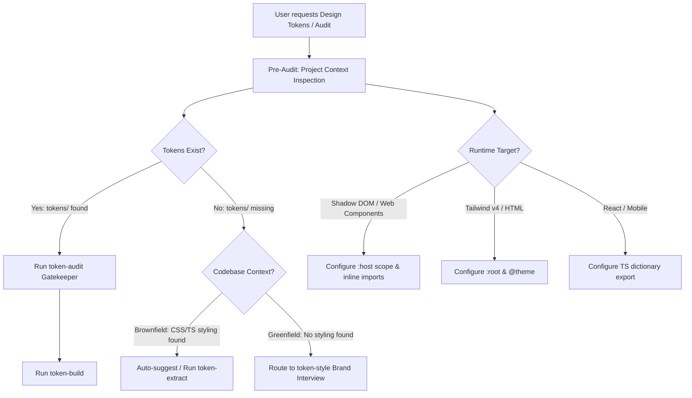

# Strategic Audit Feedback & Architectural Critique for `token-*` Skills

## Executive Summary

Following a complete, end-to-end integration of the `token-*` design token skills suite into a production TypeScript monorepo (`hordes-automation`), this report provides direct, evidence-based answers to three fundamental architectural questions:

1. **Is installing `Style Dictionary` mandatory or optional? Should the skills prompt the user regarding toolchain companions (Prettier, Biome, Stylelint, PostCSS, etc.)?**
2. **Is pre-auditing the project context to understand the current design system before running scripts a superior strategy?**
3. **Why don't we produce an audit report before running the generation scripts?**

Our empirical findings confirm that the current suite has an exceptional color-science and mathematical core (OKLCH ramps, APCA calculation, and deterministic generation), but suffers from pipeline sequencing gaps and unhandled assumptions about consumer environments. Below is the detailed analysis and proposed architecture.

---

## Question 1: Is Installing Style Dictionary Mandatory or Optional? Should We Ask the User?

### 1.1 Technical Reality: It Should Be Strictly Optional
In our trial, we observed an architectural contradiction:
- `C:\Users\toanh\.agents\skills\token-build\scripts\build.mjs` **already bundles an internal, standalone Style Dictionary engine**.
- When running `node <token-build-root>/scripts/build.mjs --tokens tokens --out dist ...`, the script successfully generated `tokens.css`, `theme.css`, `components.md`, and `DESIGN.md` **without requiring `style-dictionary` in the consumer project's `package.json`**.
- Conversely, when the user subsequently prompted *"please install Style Dictionary, then reflect to our hardcoded values"*, running `pnpm add -Dw style-dictionary` pulled in **104 additional npm packages** into the consumer's `node_modules`.

**The Verdict:** Installing `style-dictionary` into the consumer project MUST be **strictly optional** (progressive enhancement).
- **Default (Zero-Dependency):** The bundled runner in `token-build` should compile CSS and token outputs without touching the consumer's `package.json`.
- **Advanced (Local Install):** Only install `style-dictionary` locally if the consumer specifically wants to write custom transforms, register proprietary formatters, or execute `style-dictionary build` directly in their own CI pipelines.

### 1.2 The "Toolchain Companion Matrix": Should We Ask the User?
**Yes, unequivocally.** In autonomous agent engineering, silently injecting dependencies into a user's repository violates core safety principles ("Never install/remove dependencies unless explicitly asked").

When bootstrapping or building design tokens, the agent/CLI should present an interactive prompt or companion matrix allowing the user to opt into their preferred toolchain:

| Tool Category | Options | Rationale & Recommendation |
| :--- | :--- | :--- |
| **Token Compiler** | **[1] Bundled zero-dep runner (Recommended)**<br>[2] Local `style-dictionary` in `package.json` | Keeps consumer `package.json` lightweight unless custom transforms are needed. |
| **Formatters** | **[1] Existing project formatter (Recommended)**<br>[2] Prettier (`.prettierrc`)<br>[3] Biome (`biome.json`) | Respects project standards; prevents conflicting formatting rules in CI. |
| **CSS Processors** | **[1] Pure CSS / Native Variables (Recommended)**<br>[2] Tailwind v4 (`@theme`)<br>[3] PostCSS / LightningCSS | Different frontends consume tokens differently (e.g., Shadow DOM vs. Tailwind). |
| **Token Guardrails** | **[1] None (Rely on PR audit)**<br>[2] Stylelint with `stylelint-declaration-strict-value`<br>[3] ESLint token plugin | Linters can actively fail builds if a developer writes raw `#hex` instead of `var(--color-*)`. |

**Recommendation:**
Provide an optional interactive scaffolding command (e.g. `kami init --interactive` or `token-build --scaffold`) that presents this structured questionnaire before modifying `package.json`.

---

## Question 2: Is Pre-Auditing the Project Context a Better Strategy?

### 2.1 The "Cold Start" Failure Mode
During our initial run, the user prompted:
> *"[IMPORTANT: User invoked the "token-audit" skill; follow its instructions.]"*

Because `token-audit` assumes `tokens/` already exists, running it on a fresh project resulted in an unhandled crash:
```
tokens dir not found: C:\Users\toanh\Desktop\Projects\Automation\tokens
Command exited with code 1
```
The agent was stopped cold. There was no inspection of the workspace to determine:
- Does this repository have existing CSS that can be extracted?
- Is this a greenfield project with no styling?
- Is this a Tailwind, Web Component, or vanilla CSS codebase?

### 2.2 Why Pre-Auditing Is Unequivocally Superior
Pre-auditing the project context before running any token script completely eliminates out-of-sequence failures and gives the agent the intelligence needed to execute smoothly.



### 2.3 Context Discovery Dimensions
A pre-audit step (e.g., `kami inspect` or `token-extract --audit-context`) should automatically detect three critical dimensions:
1. **Maturity (Greenfield vs. Brownfield):**
   - If `.css`, `.scss`, or styled components exist $\to$ Route to `token-extract` to mine existing colors as evidence.
   - If empty repository $\to$ Route to `token-style` for Socratic palette design.
2. **Framework & Architecture:**
   - Detects whether the project uses Web Components with Shadow DOM (which requires `:host` scoped custom properties) or standard DOM (`:root`).
3. **Existing Tooling & Package Manager:**
   - Detects `pnpm`, `npm`, `yarn`, or `bun`, avoiding package manager mismatch during builds.

---

## Question 3: Why Don't We Produce an Audit Report BEFORE Running Generate Scripts?

### 3.1 The Missing "Before" in the "Before-and-After" Story
Currently, `token-audit` only runs **after** `token-math` has already generated the 3-tier DTCG tokens. While this provides a post-generation gatekeeper, it misses the most compelling part of design system engineering: **proving that the new tokens fixed real production problems.**

When `token-extract` ran on `hordes-automation`, it discovered colors currently used in production:
- `#10131dcc` (background)
- `#5b858e` (subdued header text)
- `#dae8ea` (body text)
- `#38bdf8` (action accent)

Notice what was missing: **Nobody evaluated whether `#5b858e` on `#10131dcc` had legal contrast in production today!**
In fact, low-luminance slate text on a dark translucent panel often fails WCAG AA ($< 4.5:1$).

### 3.2 The Power of a Pre-Generation Audit Report
If `token-extract` (or a pre-audit tool) generated a **`pre-audit-baseline.md`** before running `token-math`:
1. **Quantifies Production Accessibility Debt:**
   - Lists all color pairs found in existing CSS.
   - Tests them against WCAG and APCA.
   - Emits a baseline scorecard: *"Found 18 color pairs: 6 pass, 12 FAIL WCAG AA."*
2. **Provides Mathematical Justification for Token Adoption:**
   - When managers or engineers ask *"Why do we need design tokens?"*, the pre-audit provides undeniable evidence: *"Because our current production buttons fail accessibility standards."*
3. **Validates the Fix:**
   - After `token-math` computes the OKLCH ramps and `token-audit` passes with 42/42 pairs green, the team can view a before-and-after comparison table:
   
   | Role Pair | Pre-Audit (Production As-Is) | Post-Audit (Tokenized Math) | Verdict |
   | :--- | :--- | :--- | :--- |
   | Muted Header on Panel | 3.12:1 (FAIL) | 9.05:1 / Lc 63.9 (PASS) | **Fixed by Token Math** |
   | Warning Pill Text | 3.84:1 (FAIL) | 6.27:1 / Lc 78.5 (PASS) | **Fixed by Token Math** |
   | Action Button Text | 4.10:1 (FAIL) | 17.09:1 / Lc 102.6 (PASS) | **Fixed by Token Math** |

### 3.3 Why Can't `token-audit` Run on Raw CSS Today?
`token-audit`'s script (`audit.mjs`) is tightly coupled to the 3-tier DTCG structure: it resolves `{color.neutral.700}` aliases across JSON files. It cannot parse raw `.css` or `.ts` files.
By creating a lightweight **Pre-Audit / Inventory Scanner** in `token-extract` that pairs extracted text colors with their nearest background container, teams can generate an **As-Is Baseline Contrast Report** prior to running token generation.

---

## 4. The Proposed Architecture: The "Dual-Audit" Pipeline

To unify these insights, we recommend structuring the `token-*` suite into a coherent, resilient **Dual-Audit Pipeline**:

```
+-----------------------------------------------------------------------------------+
|                           THE DUAL-AUDIT TOKEN PIPELINE                           |
+-----------------------------------------------------------------------------------+
                                          |
                                          v
+-----------------------------------------------------------------------------------+
| STAGE 0: Pre-Audit & Project Context Discovery                                     |
| Command: node <skill-root>/scripts/discover.mjs                                   |
| - Inspects workspace: detects Greenfield vs. Brownfield                           |
| - Detects runtime: Shadow DOM (:host) vs. DOM (:root) vs. Tailwind                 |
| - Prompts user: Optional toolchain companions (Prettier, Biome, Stylelint)        |
+-----------------------------------------------------------------------------------+
                                          |
                                          v
+-----------------------------------------------------------------------------------+
| STAGE 1: As-Is Baseline Audit & Spec Extraction (token-extract)                   |
| Command: node <extract-root>/scripts/extract.mjs --audit-baseline                  |
| - Extracts candidate anchors into style-spec.json                                 |
| - Generates docs/pre-audit-baseline.md (Current production contrast flaws)       |
+-----------------------------------------------------------------------------------+
                                          |
                                          v
+-----------------------------------------------------------------------------------+
| STAGE 2: Deterministic Generation (token-math)                                    |
| Command: node <math-root>/scripts/generate.mjs --spec style-spec.json              |
| - Computes OKLCH ramps & 4px rhythm scales                                        |
| - Emits 3-tier DTCG tokens/ tree (primitive/, semantic/, component/)              |
+-----------------------------------------------------------------------------------+
                                          |
                                          v
+-----------------------------------------------------------------------------------+
| STAGE 3: Post-Generation Gatekeeper (token-audit)                                 |
| Command: node <audit-root>/scripts/audit.mjs --tokens tokens                       |
| - Evaluates all themes (dark, light, high-contrast) against WCAG & APCA           |
| - Generates Before-vs-After contrast delta report                                 |
| - Emits cryptographic .token-engine-audit.json stamp                              |
+-----------------------------------------------------------------------------------+
                                          |
                                          v
+-----------------------------------------------------------------------------------+
| STAGE 4: Zero-Dep Compilation & Packaging (token-build)                           |
| Command: node <build-root>/scripts/build.mjs --theme all --format css,ts          |
| - Uses bundled Style Dictionary (0 consumer dependencies required)                |
| - Emits CSS custom properties (:host / :root aware)                               |
| - Emits typed TypeScript dictionary (index.js, index.d.ts)                        |
| - Optionally scaffolds @tokens workspace package                                  |
+-----------------------------------------------------------------------------------+
```

---

## 5. Summary of Key Architectural Takeaways

1. **Keep `Style Dictionary` optional for consumers**: Rely on `token-build`'s bundled compiler for zero-dependency adoption; only add `style-dictionary` to consumer `package.json` if custom pipelines are requested.
2. **Always ask before adding companion tools**: Present an interactive choice for Prettier/Biome, Stylelint, and PostCSS during setup rather than silently adding dependencies.
3. **Always pre-audit context first**: Inspecting the repository before executing scripts prevents out-of-order crashes (`tokens dir not found`) and automatically routes the agent between greenfield interviews and brownfield extractions.
4. **Produce a Pre-Audit Baseline Report before generation**: Documenting existing production contrast failures *before* running `token-math` turns token adoption from an abstract chore into an undeniable, measurable accessibility victory.
