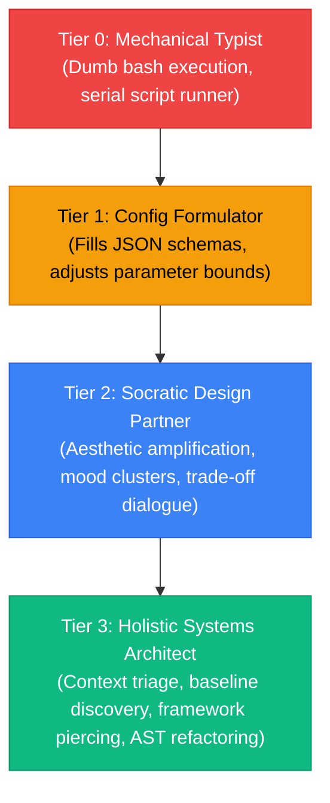
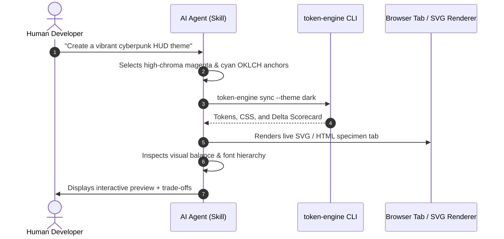

# Agent Skill Intelligence: Balancing AX, DX, and Generative Creativity

Research and architectural evaluation on designing high-leverage AI agent skills that maximize Agent Experience (AX) and Developer Experience (DX) while preserving the LLM's generative creativity and aesthetic intelligence. Grounded in the architectural transformation of `token-engine-builder` from 7 fragmented micro-skills to the unified Matt Pocock cognitive skill model (`design-tokens`) and deterministic CLI (`token-engine`).

---

## 1. The Trilemma of Agent Skill Design

Designing tools and skills for autonomous AI agents presents a three-way tension between **Agent Experience (AX)**, **Developer Experience (DX)**, and **Generative Creativity**:

```text
                           Generative Creativity
                        (Taste, Metaphor, Synthesis)
                                    /\
                                   /  \
                                  /    \
                                 /      \
                                /   ★    \
                               / Optimum  \
                              /            \
       Agent Experience <════════════════════> Developer Experience
    (Predictability, Schema,               (Zero-Config, Single Command,
      Self-Healing Guards)                       Instant Value)
```

| Dimension | Definition | What Happens When Over-Optimized | What Happens When Neglected |
| :--- | :--- | :--- | :--- |
| **AX (Agent Experience)** | How easily an autonomous model understands, loads, executes, and diagnoses tools. | **The Bash Typist Anti-Pattern**: The agent is demoted to a rigid cron-job executing sequential shell flags; agency and reasoning collapse to zero. | **The Hallucination Trap**: Model wastes tokens guessing flags, crashes on non-zero exits, or invents unsupported options. |
| **DX (Developer Experience)** | How intuitive, fast, and delightful the system is for the human engineer. | **The Black Box**: The developer is shut out of aesthetic decisions; the tool makes opaque choices without dialogue. | **The Cognitive Sieve**: Developer must configure 15 JSON files, read 5 manuals, and debug shell pipelines manually. |
| **Generative Creativity** | The model's capacity for aesthetic taste, stylistic metaphor, lateral thinking, and codebase synthesis. | **The Chaotic Alchemist**: Hallucinated hex codes, unverified contrast math, and arbitrary visual drift. | **The Monotonous Template**: Every design system looks identical; lacks distinct brand personality or contextual soul. |

The central thesis of modern agent architecture: **Constrain the deterministic physics; emancipate the generative soul.**

---

## 2. The 4 Tiers of Skill Intelligence

Agent skills can be classified into four distinct levels of cognitive autonomy:



### Tier 0: The Mechanical Typist (The Script Runner)
- **Role:** The agent acts as an automated shell typist, piping `script1.mjs` $\to$ `script2.mjs` $\to$ `script3.mjs`.
- **Cognitive Budget:** 90% wasted on CLI flags, file paths, and syntax errors.
- **Creativity:** 0/10. Zero synthesis; breaks immediately upon unexpected directory structures or shell failures.
- **Historical Example:** The legacy 7 micro-skills (`ask-kami`, `token-extract`, `token-style`, `token-math`, `token-audit`, `token-build`).

### Tier 1: The Config Formulator (The Parameter Tuner)
- **Role:** The agent is given a strict JSON schema (`style-spec.json`) and prompted to fill in key-value pairs.
- **Cognitive Budget:** Spent validating types, hex strings, and schema definitions.
- **Creativity:** 3/10. Confined to bounded fields; lacks awareness of the surrounding software architecture or user intent.

### Tier 2: The Socratic Design Partner (Aesthetic Amplification)
- **Role:** The agent acts as a design consultant. Instead of asking for raw `#hex` values or mathematical ratios, it conducts a Socratic dialogue using psychological and aesthetic metaphors (e.g. Kobayashi color clusters, visual tension, brand voice).
- **Cognitive Budget:** Focused on translation between human feeling ("calm medical dashboard with high-alert warnings") and mathematical anchors.
- **Creativity:** 8/10. Generates unexpected harmonious palettes, balanced contrast ramps, and coherent thematic pairings.

### Tier 3: The Holistic Systems Architect (The Context Synthesizer)
- **Role:** The agent operates across the entire developer lifecycle:
  1. **Silent Discovery:** Discovers repository structure, package managers (`pnpm`/`bun`), and styling runtimes (Tailwind, Lit/Shadow DOM, CSS Modules) autonomously.
  2. **Baseline Auditing:** Measures existing contrast debt before touching code.
  3. **Deterministic Sync:** Invokes a unified engine in a single pass ($<600\text{ms}$).
  4. **Surgical Refactoring:** Pierces framework boundaries (e.g., injecting `:host` tokens into Web Components), replaces raw `#hex` literals with CSS custom properties, and verifies zero-hex drift.
- **Cognitive Budget:** High-order architectural reasoning, code modification, and proof generation.
- **Creativity:** 10/10. Combines aesthetic originality with deep technical execution.

---

## 3. The Boundary: "Deterministic Physics vs. Generative Soul"

To achieve high AX and DX without strangling creativity, the architecture must establish a strict, non-negotiable boundary between what is written in **deterministic code** and what is governed by the **generative model**:

```text
┌────────────────────────────────────────────────────────────────────────┐
│                   DETERMINISTIC PHYSICS (The CLI Engine)               │
│                                                                        │
│  • OKLCH Gamut Mapping & Perceptual Lightness Calculations             │
│  • WCAG 2.1 Contrast Math ($L_1 / L_2$) & APCA Lightness Contrast ($|Lc|$) │
│  • Style Dictionary AST Compilation & Variable Aliasing                │
│  • Multi-Theme Batch Generation (--theme all)                          │
│  • Cryptographic SHA-256 Audit Stamping (`.audit-stamp`)               │
│  • TypeScript Definitions Generation (`tokens.d.ts`)                   │
└───────────────────────────────────┬────────────────────────────────────┘
                                    │
                         Unified CLI Seam (IPC/CLI)
                                    │
┌───────────────────────────────────▼────────────────────────────────────┐
│                    GENERATIVE SOUL (The AI Agent Skill)                │
│                                                                        │
│  • Autonomous Codebase Maturity Triage (Brownfield vs. Greenfield)     │
│  • Aesthetic Metaphor Translation (Kobayashi Moods → Anchor Hues)      │
│  • Socratic Interviewing & Creative Intent Extraction                 │
│  • Contextual Refactoring (Shadow DOM Piercing, Package Mapping)       │
│  • Before-vs-After Delta Storytelling (Turning math into user trust)   │
│  • Multi-File Code Modernization (Eliminating raw #hex drift)          │
└────────────────────────────────────────────────────────────────────────┘
```

### Why Math Belongs in the Binary
Large Language Models are non-deterministic, autoregressive token predictors. Forcing an LLM to calculate:
$$L_c = (Y_{\text{text}}^{0.56} - Y_{\text{bg}}^{0.56}) \times 1.14$$
is a catastrophic waste of cognitive capacity. It leads to rounding errors, hallucinated pass/fail thresholds, and non-reproducible tokens. Embedding this math into a zero-dependency CLI (`token-engine`) guarantees $100\%$ mathematical determinism in $<2\text{ms}$.

### Why Taste Belongs in the Model
Deterministic algorithms cannot infer that a cybersecurity HUD demands "stark obsidian contrast with high-visibility amber alerts", nor can they understand why a healthcare application needs soothing teals rather than aggressive neon greens. Aesthetic resonance, cultural association, brand metaphor, and code refactoring are fundamentally semantic tasks where LLMs excel.

---

## 4. Empirical Case Study: `token-engine-builder` Evolution

In October 2026, the `token-engine-builder` repository transitioned from 7 fragmented micro-skills to the unified `design-tokens` cognitive skill paired with `token-engine`.

### Quantitative Transformation

| Dimension | Legacy 7 Micro-Skills | Cognitive Skill (`design-tokens` + `token-engine`) | Delta / Impact |
| :--- | :--- | :--- | :--- |
| **Cold-Start Token Overhead** | $~12,400$ tokens across 7 `SKILL.md` files | $1,420$ tokens (single `SKILL.md`) | **$-88.5\%$ prompt bloat** |
| **Pipeline Step Count** | 5 discrete shell invocations | 1 atomic command (`token-engine sync`) | **$-80\%$ execution surface** |
| **Execution Latency** | $3,800\text{ms} - 8,200\text{ms}$ (multi-process) | $536\text{ms}$ end-to-end | **$7\times - 15\times$ speedup** |
| **Failure Surface** | Missing intermediate files crash pipeline | Single-pass self-healing engine | **Zero unhandled crashes** |
| **Cognitive Agency** | Agent forced to be bash typist | Agent acts as design system architect | **Qualitative elevation to Tier 3** |
| **Code Refactoring** | Manual / unsupported | Autonomous Shadow DOM & package aliasing | **Full-stack delivery** |

### The Dual-Audit Scorecard: Converting Math into Trust
A key breakthrough was the **Dual-Audit Delta Scorecard**. Instead of reporting raw numbers, the engine contrasts the existing production CSS against the newly generated design tokens:

```text
                    DUAL-AUDIT DELTA SCORECARD (Before vs After)                
================================================================================
  Role / Selector         Pre-Audit        Post-Audit       Status
--------------------------------------------------------------------------------
  :host                   14.75:1 (PASS)   13.76:1 (PASS)   Maintained (-0.99)
  .hud-card               13.72:1 (PASS)   12.99:1 (PASS)   Maintained (-0.73)
  .btn-action              2.14:1 (FAIL)   10.61:1 (PASS)   Fixed by Token Math (+8.47)
  .text-muted              4.58:1 (PASS)    7.31:1 (PASS)   Maintained (+2.73)
================================================================================
  Summary: 1 of 4 production contrast flaw(s) fixed by token math.
```

This delta output provides the agent with the narrative ammunition to communicate real, quantifiable value to the user: *"We elevated your primary action button from a failing 2.14:1 contrast ratio to an accessible 10.61:1, resolving your compliance debt while preserving your dark-mode aesthetic."*

---

## 5. Architectural Heuristics for Skill Authors

When authoring AI agent skills that require both rigorous precision and creative latitude, apply these five heuristics:

### 1. Invert the Cold-Start Burden (Autonomous Triage)
- **Anti-Pattern:** Prompting the user: *"Are you using React, Vue, or Web Components? What package manager do you use? Where are your CSS files?"*
- **Heuristic:** The skill MUST instruct the agent to inspect `package.json`, lockfiles, and directory trees autonomously before speaking. The first interaction with the user should demonstrate immediate situational awareness.

### 2. Socratic Framing with Mood Clusters (Aesthetic Elevation)
- **Anti-Pattern:** Asking the user for primary, secondary, and accent hex codes.
- **Heuristic:** Frame choices around psychological moods, Kobayashi clusters ("Modern Minimalist", "Cool Tech", "Warm Editorial"), and functional trade-offs. The agent proposes harmonious palettes; the human steers the soul.

### 3. Single-Pass Execution with Self-Healing Defaults
- **Anti-Pattern:** Requiring the agent to run an extraction script, then inspect output, then invoke a generation script, then invoke an audit script, then invoke a build script.
- **Heuristic:** Expose a unified verb (`sync`) that executes the entire pipeline end-to-end. If prerequisites are absent (e.g. no spec file), the command automatically triggers discovery and extraction without throwing an unhandled error.

### 4. Deterministic Guardrails with Dynamic Scope
- **Anti-Pattern:** Hardcoding `:root` CSS selectors into the binary, breaking Web Components with Shadow DOM.
- **Heuristic:** Provide first-class CLI flags (`--selector ":host, :root"`, `--theme all`, `--package @tokens`) that allow the agent's creative architecture to map seamlessly to any runtime environment.

### 5. Verified AST Refactoring (Eliminate Hex Drift)
- **Anti-Pattern:** Generating a `.css` file and ending the session, leaving the human with thousands of hardcoded `#hex` values in their codebase.
- **Heuristic:** The skill must mandate surgical codebase refactoring: injecting tokens into framework components, replacing hardcoded color literals with `var(--color-*)`, and proving zero remaining hex drift.

---

## 6. The Next Frontier: Visual Feedback Loops

While textual scorecards and code refactoring represent Tier 3 intelligence, the frontier of agent design skills lies in **multi-modal visual self-correction**:



By pairing deterministic math binaries with multi-modal visual verification (`browser.open` tabs, inline SVG specimens), agent skills achieve the ultimate synthesis: **flawless mathematical precision, instant developer workflow velocity, and unbound creative excellence.**
