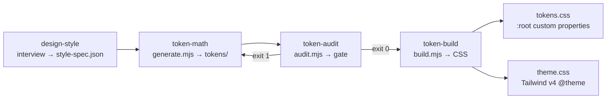
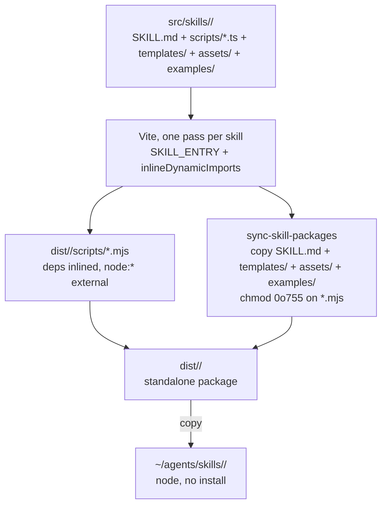
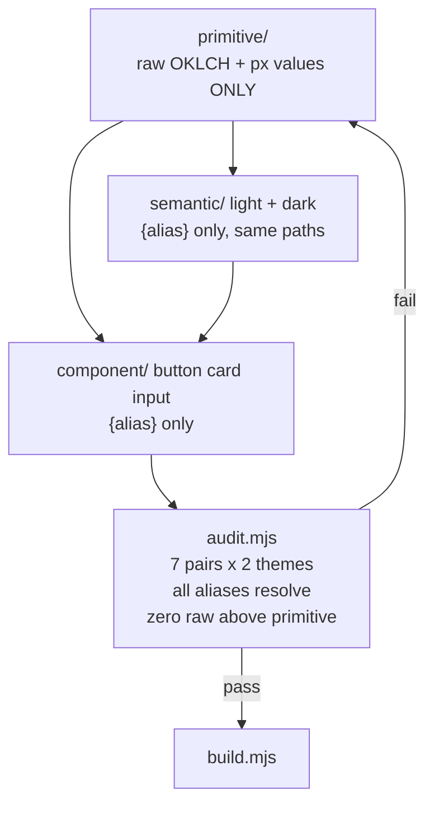

# Architecture flowcharts — token-engine-builder

Visual companion to [`ARCHITECTURE.md`](../../ARCHITECTURE.md). Source of truth stays there; these diagrams mirror it.

## 1. End-to-end token pipeline

## 2. Per-skill build and packaging

## 3. Tier alias discipline and the audit gate

