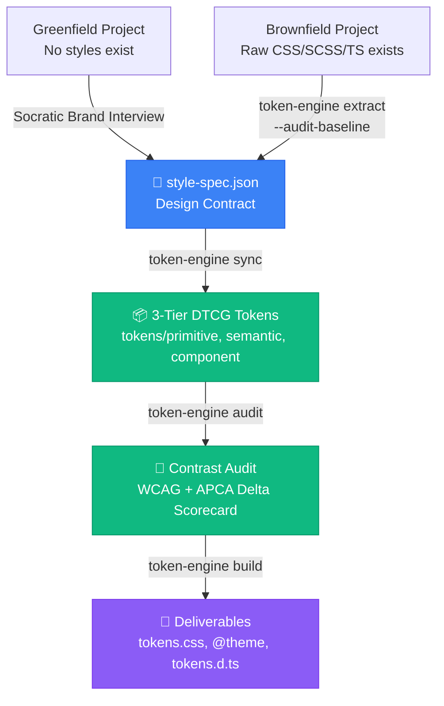

# The `StyleSpec` Design Contract: Architecture, Provenance, and Remediation

Research and architectural documentation on the role of `style-spec.json` in modern design token engineering. Grounded in the design system architecture of `token-engine-builder`.

---

## 1. The Core Philosophy: "Intent vs. Expansion"

A common trap in design token engineering is attempting to manage design systems by directly editing token files. In a production-grade W3C DTCG system, a complete token architecture consists of:
- **3 Architectural Tiers**: `primitive/` (raw scales), `semantic/` (contextual intent), and `component/` (scoped slots).
- **3 Polarized Themes**: `light.json`, `dark.json`, and `high-contrast.json`.
- **Hundreds of Discrete Variables**: Modular typography steps, 4px grid rhythm, corner radiuses, and 11-step OKLCH color ramps across 4+ palettes.

Directly editing 20+ JSON files or thousands of lines of compiled CSS creates severe failure modes:
1. **Cognitive Overload**: Humans and AI agents lose track of alias reference graphs across files (`{color.action.primary}` $\to$ `{color.blue.600}`).
2. **Silent Drift**: Changing a color in one component or theme breaks accessibility contrast in another.
3. **Loss of Reproducibility**: Re-running an automated generator or build tool wipes out manual tweaks.

### The Solution: A Compact Declarative Contract
The `StyleSpec` contract (`style-spec.json`) solves this by strictly separating **Design Intent** from **Mathematical Expansion**:

```text
┌────────────────────────────────────────────────────────────────────────┐
│                   HUMAN / AGENT INTENT (20 lines)                      │
│                                                                        │
│   • 3 Brand Anchors in OKLCH (Primary, Secondary, Accent)              │
│   • 1 Neutral Tint Hue & Chroma                                        │
│   • 1 Typography Modular Scale Ratio (e.g. 1.25)                       │
│   • 1 Spacing Base & Density (e.g. 4px, comfortable)                   │
│   • 1 Minimum Contrast Target (e.g. 4.5:1)                             │
└───────────────────────────────────┬────────────────────────────────────┘
                                    │
                         Deterministic Token Math
                                    │
┌───────────────────────────────────▼────────────────────────────────────┐
│                  DTCG TOKEN EXPANSION (Hundreds of Lines)              │
│                                                                        │
│   • 11-step OKLCH lightness ramps (50–950) clamped to sRGB             │
│   • Dual-gate contrast auditing (WCAG 2.1 AA + APCA |Lc| ≥ 60)         │
│   • Multi-theme semantic polarity inversion                            │
│   • CSS variables, Tailwind @theme, and typed TypeScript dictionaries  │
└────────────────────────────────────────────────────────────────────────┘
```

The developer or AI agent only needs to reason about the 20 lines of intent in `style-spec.json`. The mathematical engine deterministically expands this intent into complete, accessible token trees.

---

## 2. The Anatomy of the `StyleSpec` Contract

Defined in TypeScript as `StyleSpec` (`src/shared/types.ts`):

```json
{
  "name": "Acme Brand",
  "palette": [
    { "role": "primary", "anchor": "oklch(60% 0.15 250deg)" },
    { "role": "secondary", "anchor": "oklch(65% 0.12 180deg)" },
    { "role": "accent", "anchor": "oklch(75% 0.16 70deg)" }
  ],
  "neutral": { "hue": 250, "chroma": 0.02 },
  "typography": {
    "fontFamily": "Inter, sans-serif",
    "baseSizePx": 16,
    "ratio": 1.25,
    "baseLineHeight": 1.5
  },
  "spacingBasePx": 4,
  "density": "comfortable",
  "radius": { "sm": 4, "md": 8, "lg": 16, "full": 9999 },
  "targets": { "minWcagRatio": 4.5 }
}
```

### Key Dimensions
1. **Palette Anchors**: Color science begins with 3 to 5 OKLCH anchors. OKLCH is chosen because perceptual lightness ($L$) is mathematically decoupled from chroma ($C$) and hue ($H$), unlike sRGB or HSL.
2. **Neutral Hue Harmonization**: Rather than dead, neutral gray, the neutral ramp is subtly tinted with the brand's primary hue (`neutralHue: 250`), producing sophisticated, cohesive surfaces.
3. **Modular Typography Ratio**: A single multiplier (e.g. $1.25$ Major Third for desktop web, $1.2$ Minor Third for compact dashboards) derives all font sizes and line heights on a 4px vertical rhythm grid.
4. **Spatial Density**: Controls whether spacing increments expand for spacious marketing pages (`comfortable`) or tighten for data-dense HUDs (`compact`).

---

## 3. Cryptographic Provenance & Tamper Detection

In an enterprise CI/CD pipeline, how do you verify that the compiled CSS in production matches the approved design spec?

`token-engine-builder` implements **Cryptographic Provenance** (`src/shared/guard.ts`):
1. **Canonical JSON Hashing**:
   The engine serializes `style-spec.json` into canonical, key-order-insensitive JSON and computes its SHA-256 hash:
   $$\text{specInputHash} = \text{SHA-256}(\text{canonicalJson}(\text{StyleSpec}))$$
2. **Manifest Binding**:
   When tokens are generated into `tokens/`, the engine writes `tokens/.token-engine-manifest.json`, recording:
   - `inputHash`: The exact SHA-256 hash of `style-spec.json`.
   - `fileHashes`: The SHA-256 hash of every generated primitive and semantic JSON file.
3. **Tamper Detection (`checkSpecBinding`)**:
   During `token-engine audit` or `token-engine build`, the guard compares the current `style-spec.json` against the manifest. If a developer manually tampers with a token file or modifies the spec without running generation, the pipeline fails closed with a tamper warning.

---

## 4. The Remediation Seam: Durable Overrides

Accessibility contrast failures inevitably occur in complex themes (e.g., secondary muted text on a raised card surface in dark mode).

### The Anti-Pattern: Hacking Intermediate Files
If an engineer edits `tokens/semantic/dark.json` or `build/tokens.css` to fix the contrast ratio, their fix is **ephemeral**: the next time `token-engine sync` runs, their manual edits are overwritten.

### The Solution: Durable Overrides in `style-spec.json`
`StyleSpec` provides a first-class `"overrides"` field designed specifically as a **remediation seam**:

```json
{
  "name": "Acme Brand",
  "palette": [...],
  "overrides": {
    "dark": {
      "semantic.color.text.secondary": "{color.neutral.300}"
    }
  }
}
```

When `token-engine audit` detects a contrast failure, it calculates a **Remedy Suggestion** indicating the exact ramp step needed to pass. Recording this suggestion in `style-spec.json` applies the override in-memory during generation, guaranteeing a permanent, version-controlled fix that survives automated rebuilds.

---

## 5. Universal Bridge: Greenfield and Brownfield Convergence

`style-spec.json` serves as the universal convergence point between brand-new projects and legacy codebases:



- **Greenfield Workflow**: The AI Agent conducts a brief Socratic interview based on Kobayashi mood clusters, captures the decisions, and writes `style-spec.json`.
- **Brownfield Workflow**: The AI Agent runs `token-engine extract --audit-baseline`, mines existing production colors, resolves contrast debt, and writes `style-spec.json`.

From the moment `style-spec.json` is created, the entire downstream toolchain (`sync`, `audit`, `build`) behaves identically.

---

## 6. Summary: Why AI Agents Benefit From `style-spec.json`

For an autonomous AI agent, `style-spec.json` provides maximum **cognitive leverage**:
- **Small Context Surface**: The agent reads and edits 20 lines of JSON instead of parsing 20 files and 2,000 lines of token syntax.
- **Clear Seam of Responsibility**: The agent owns the creative parameters in `style-spec.json`; the deterministic CLI (`token-engine`) owns the arithmetic and compilation.
- **Fail-Safe Iteration**: Changing brand aesthetics or fixing accessibility debt is a single-field edit in one file.

---

## 7. Ecosystem Evolution: From `style-spec.json` to `tokens.config.json`

In frontend engineering, conventions matter for cognitive friction. The original name `style-spec.json` suffered from subtle ambiguities:
1. **Semantic Drift**: "Style" often connotes visual CSS rules or inline styles rather than a design token engine contract.
2. **Ecosystem Misalignment**: Frontend developers expect tooling configurations to follow the `*.config.*` pattern (`tailwind.config.js`, `vite.config.ts`, `prettier.config.json`).

### The Canonical Convention: `tokens.config.json`
The system designates `tokens.config.json` as the primary configuration file:
- **Immediate Recognition**: Any engineer or AI agent seeing `tokens.config.json` in a repository immediately recognizes it as the source of truth for the token build system.
- **Transparent Backwards Compatibility**: The path resolution engine (`resolveSystemPaths`) automatically checks for `tokens.config.json` first, then falls back to `style-spec.json` if present. Legacy codebases and existing CI workflows operate without disruption.
